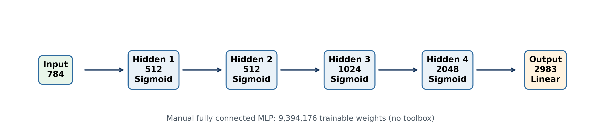
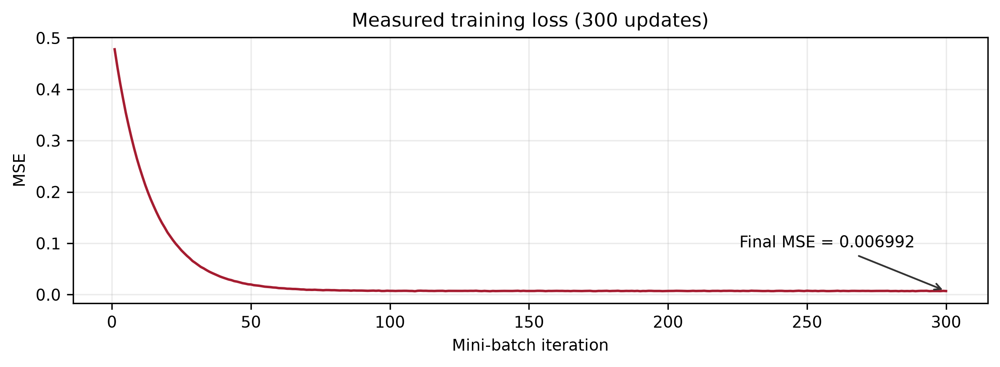
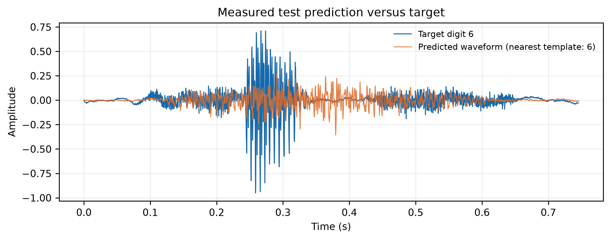

# Handwritten digit to speech

Give the network a 28x28 MNIST digit and it outputs the audio waveform of that
digit being spoken (2,983 samples at 4 kHz). It's a regression problem, not a
classifier: every output neuron is one audio sample.

Forward pass and backprop are written by hand in NumPy, no autodiff. There's
also a MATLAB version of the same thing (`fc.m`, `bc.m`, `get_audio.m`,
`lab5.m`). I didn't have MATLAB, so the results below come from the NumPy run.

## Network

```
784 -> 512 -> 512 -> 1024 -> 2048 -> 2983
       sigmoid hidden layers,   linear output
```

About 9.4M weights. MSE loss, mini-batch gradient descent, lr 0.1, batch 100,
300 iterations, Xavier init.



## Data

- [MNIST](http://yann.lecun.com/exdb/mnist/): 10,000 images (9,000 train, 1,000 test)
- [AudioMNIST](https://github.com/soerenab/AudioMNIST): one recording per digit, resampled to 4 kHz and cut to 2,983 samples

Neither is included here. `prepare_data.py` downloads both.

## Results

| | |
|---|---:|
| Train MSE, start | 0.4779 |
| Train MSE, after 300 updates | 0.0070 |
| Held-out "6" waveform MSE | 0.0035 |
| Nearest template to the prediction | 6 (correct) |
| Training time on CPU | ~28 s |




The predicted audio for a test "6" is in [`results/predicted_digit_6.wav`](results/predicted_digit_6.wav).

Honest caveat: with one recording per digit, the network is basically learning
to map each digit image to a fixed clip. It doesn't generate new voices. The
interesting part is getting a 5-layer sigmoid net with a 2,983-wide output to
train with hand-written backprop.

## Run

```bash
python prepare_data.py   # downloads data
python train_numpy.py    # trains, writes figures/ and results/
```

MATLAB: run `prepare_data.py` once to get `mnist_small_matlab.mat` and `audio/`, then run `lab5` in MATLAB.
