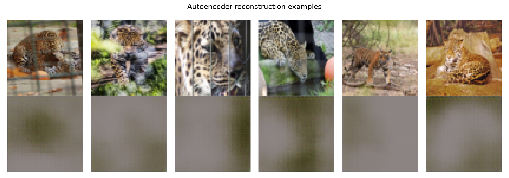
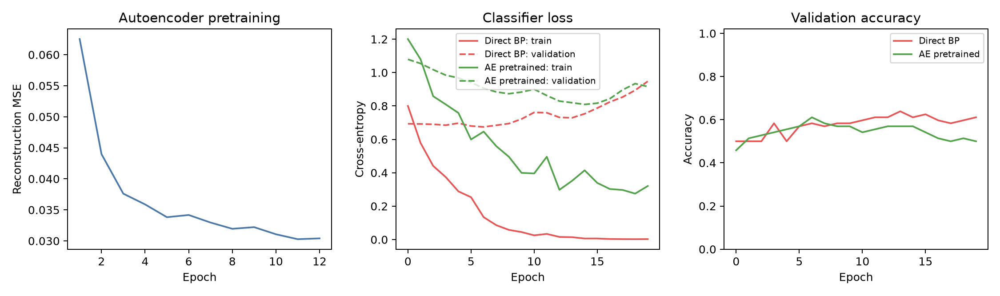
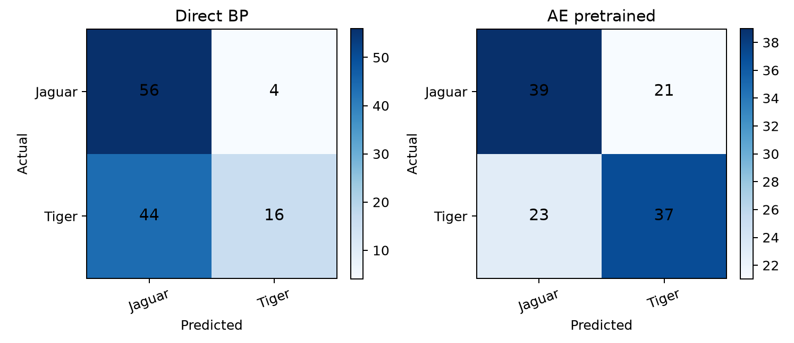

# Autoencoder pretraining when you only have 10% labels

If only 10% of the training images are labeled, does it help to first train an
autoencoder on all of them (labels ignored) and reuse its encoder?

Task: Jaguar vs Tiger. They look similar, so it's not trivially easy.
PyTorch, small conv nets, runs on CPU.

1. Stratified split: test, validation, and a training pool
2. Keep labels for only 10% of the training pool
3. Train a conv autoencoder on the whole pool, no labels
4. Train two identical classifiers on the labeled 10%:
   - **Direct BP**: encoder starts from random weights
   - **AE pretrained**: encoder starts from the autoencoder
5. Compare both on the same test set

## Data

[Animal Dataset with 15 Classes](https://www.kaggle.com/datasets/mkstar1/animal-dataset-with-15-classes-of-animals) on Kaggle (not included, ~850 MB).
Download, unzip, and point `--data-dir` at it. The script finds the class
folders even if they're nested.

## Results

Seed 42, 300 images per class, 64x64. Training pool: 408 images (40 labeled),
72 validation, 120 test.

| Model | Accuracy | Macro-F1 |
|---|---:|---:|
| Direct BP | 60.0% | 55.0% |
| AE pretrained | **63.3%** | **63.3%** |

The accuracy gap is small and the test set is only 120 images. The F1 gap is
the more telling part: the direct model guessed "Jaguar" for 100 of 120 test
images, while the pretrained one is balanced.





## Run

```bash
python animal_autoencoder.py --data-dir path/to/Dataset/train \
    --class-a Jaguar --class-b Tiger --max-per-class 300 --output-dir results
```

Options: `--labeled-fraction 0.10`, `--max-per-class 0` (all images),
`--ae-epochs 12`, `--classifier-epochs 20`, `--image-size 64`, `--seed 42`.

No leakage: folder labels are only used to make the split, the autoencoder's
target is the image itself, and val/test images aren't used in any training.
