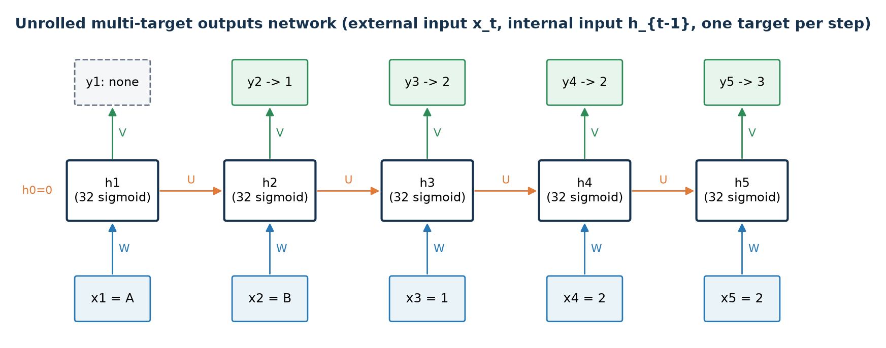
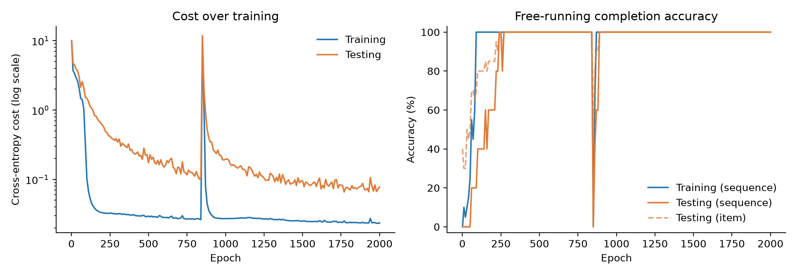
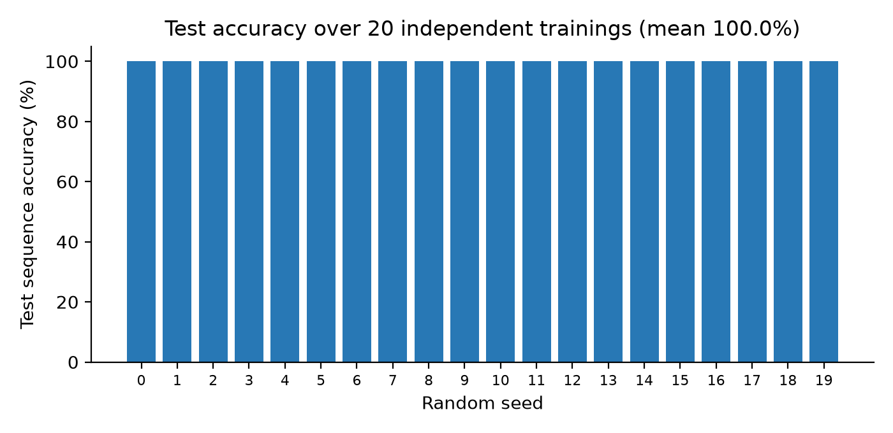
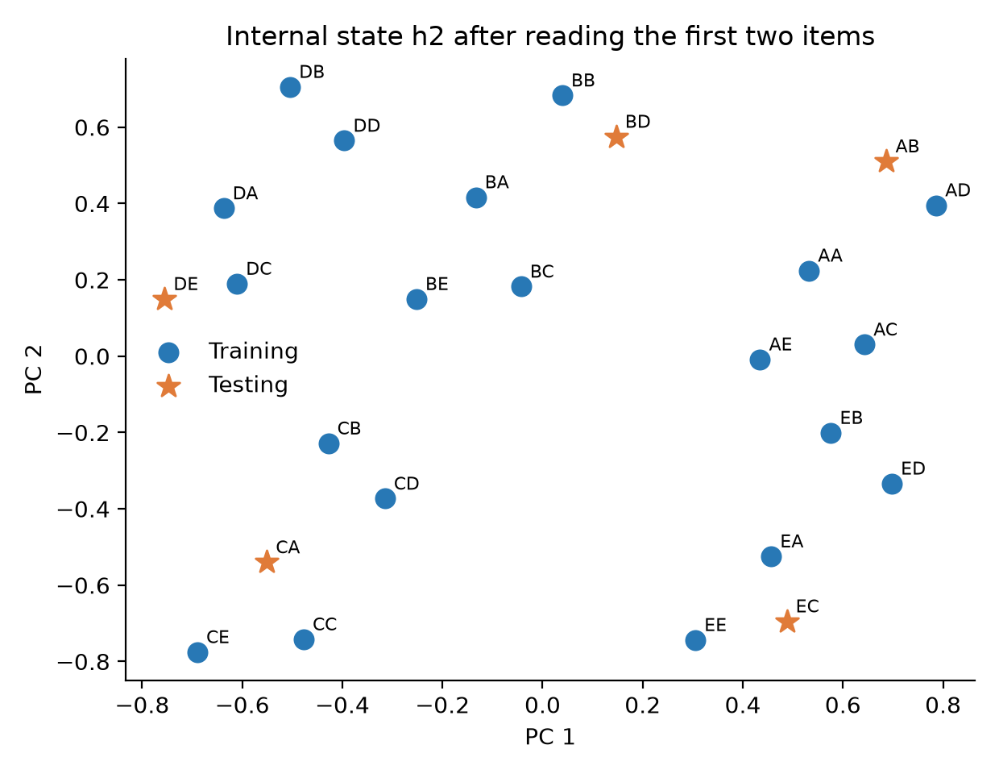

# RNN sequence completion with hand-written BPTT

Each sequence has 6 items. The first two are letters (A-E) and they fully
decide the last four digits (1-3). Example: `AB -> AB1223`. The network isn't
told the rule (A=12, B=23, C=31, D=21, E=13), it has to learn it from 20 examples.
The 5 test pairs never appear in training.

Everything is plain NumPy: forward pass, backprop through time, updates.

## Model

```
h_t = sigmoid(W x_t + U h_(t-1) + b)
y_t = softmax(V h_t + c)
```

- One-hot input over `{A,B,C,D,E,1,2,3}`
- At each step it predicts the next item. Output at t=1 is masked, since item 2 is free
- Cross-entropy summed over the 4 targets, plus L2
- At test time it gets 2 items and its own predictions are fed back in



## Checking the gradients

The BPTT gradients are compared against finite differences: max relative
error **5.5e-08**.

## Picking hyperparameters

Leave-one-out CV on the 20 training sequences only, over hidden {8, 16, 32}
x L2 {1e-4, 1e-3, 3e-3}. Best: 32 hidden, L2 1e-3 (95% LOO). The test set
isn't touched while tuning.

## Results

hidden 32, L2 1e-3, lr 0.5, batch 4, 2000 epochs

| Given | Target | Output |
|---|---|---|
| AB | AB1223 | AB1223 |
| BD | BD2321 | BD2321 |
| CA | CA3112 | CA3112 |
| DE | DE2113 | DE2113 |
| EC | EC1331 | EC1331 |

5/5 test sequences (20/20 items). Retrained with 20 different seeds, it got
100% every time.





## Run

```bash
python model_selection.py                       # LOO CV, ~13 min on CPU
python seq_completion.py --hidden 32 --l2 1e-3  # train, test, figures
```
