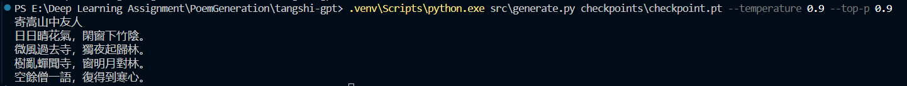

# Tang poem generation with a small GPT, plus Bengali translation

## Credits

The model code and the poem dataset are **not mine**. They come from
[tangshi-gpt](https://github.com/dengfeng-ai/tangshi-gpt) by Zhou Dengfeng
(MIT License), which is linked here as a submodule. I didn't change the
code, except for the CPU settings in [`train_cpu.patch`](train_cpu.patch).

What I did: set it up, trained it on CPU, generated a poem with the trained
checkpoint, translated it to Bengali, and worked out the layer/parameter breakdown.

## Setup

```bash
git clone --recurse-submodules https://github.com/arafat0924/deep-learning-projects.git
cd deep-learning-projects/04-tang-poem-gpt/tangshi-gpt
python -m venv .venv
.venv/Scripts/python -m pip install -r requirements.txt   # torch 2.10.0
git apply ../train_cpu.patch      # batch 64 -> 4, 10000 -> 500 iterations
.venv/Scripts/python -u src/train.py
.venv/Scripts/python src/generate.py checkpoints/checkpoint.pt --temperature 0.9 --top-p 0.9
```

## Model

Character-level, decoder-only Transformer. Trained on ~37k Tang poems
(30,087 train / 3,346 val / 3,717 test), vocab of 7,075 tokens.

| Layer | Units | Params |
|---|---|---|
| Token embedding | 256 | 1,811,200 |
| Position embedding (context 256) | 256 | 65,536 |
| Transformer block × 6 (8 heads × 32, FFN 1,024 ReLU) | 256 | 788,992 each |
| Final LayerNorm | 256 | 512 |
| Output softmax | 7,075 | 1,818,275 |
| **Total** | | **8,429,475** |

AdamW, lr 3e-4, dropout 0.2.

## Training on CPU

No GPU, so I used batch 4 and 500 iterations:

```
step 0:   train loss 9.0493, val loss 9.0459
step 499: train loss 5.7605, val loss 5.7680
```

31 minutes. Loss is going down, but 500 steps isn't enough for good poems, so
I generated with the repo's fully trained checkpoint (10,000 iterations,
train loss 3.03, val loss 3.88). Full log: [`outputs/training_output.txt`](outputs/training_output.txt)

## Generated poem

No title prompt, so the model wrote the title too:

```
寄嵩山中友人
日日晴花氣，閑窗下竹陰。
微風過去寺，獨夜起歸林。
樹亂蟬聞寺，窗明月對林。
空餘僧一語，復得到寒心。
```

"To a Friend on Mount Song". Eight lines of five characters, so the form is
a lüshi (regulated verse).



## Bengali translation

Done with Google Translate, not a trained model. Copied without changes:

```
সংশানে এক বন্ধুর প্রতি
প্রতিদিন বাতাস ফুলের সুবাসে ভরে থাকে, আর আমার জানালার নিচে বাঁশের ছাউনিটা অলসভাবে ঝুলে থাকে।
মন্দিরের পাশ দিয়ে বয়ে যায় এক মৃদু বাতাস, আর রাতে আমি একাই জেগে উঠি বনে ফিরে যাওয়ার জন্য।
মন্দিরের কাছের গাছগুলোতে ঝিঁঝিঁপোকার ডাক শোনা যায়, আর জানালা দিয়ে উজ্জ্বল চাঁদের আলো এসে বনের উপর প্রতিফলিত হয়।
কেবল এক সন্ন্যাসীর কথাই রয়ে গেছে, যা আমার হৃদয়কে আবারও হিম করে দেয়।
```

("সংশানে" is Google's attempt at 嵩山 and isn't a real word.)


